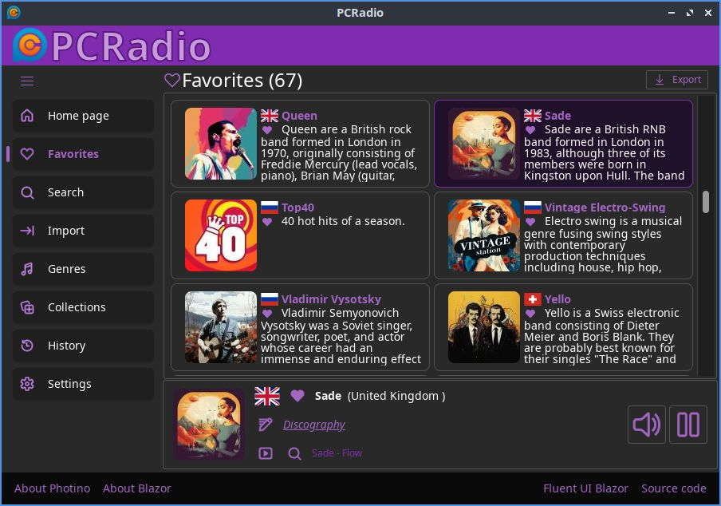

# 🎵 PCRadio — Desktop Internet Radio Player

PCRadio is a lightweight cross-platform internet radio player built with C#, .NET 10, and Photino.Blazor.
It provides a simple and modern desktop interface for listening to online radio streams from [PCRadio](https://pcradio.ru/).

[](https://dotnet.microsoft.com/download/dotnet/10.0)
[](https://dotnet.microsoft.com/languages/csharp)
[](https://opensource.org/licenses/MIT)



## ✨ Features
- Listen to online radio streams and control playback volume
- Browse recommended stations and the station catalog by genre, subgenre, and topic
- Search stations by name, country, genre, and subgenre
- Find and add stations from [Radio Browser](https://www.radio-browser.info/) by name, country, and tags
- Add stations to favorites and edit station information
- Keep a history of played stations and detected track titles
- Search for the detected track on YouTube, or find and download a selected track from [z3.fm](https://z3.fm/)
- Export recommended stations, favorites, genres, and topics as M3U playlists
- Choose the interface language (English or Russian), theme, and accent color
- Set the stream quality and download folder
- Update the station catalog from the internet or a ZIP archive
- Cross-platform builds are available for Windows and Linux; macOS packaging is supported but has not been tested
- Open-source and MIT licensed

## 🛠️ Built With
- **[.NET 10.0](https://dotnet.microsoft.com/download/dotnet/10.0)**: The core runtime and framework.
- **[C#](https://dotnet.microsoft.com/languages/csharp)**: The primary programming language.
- **[Photino.Blazor](https://github.com/tryphotino/photino.Blazor)**: A lightweight native window to host the Blazor UI.
- **[Fluent UI Blazor](https://github.com/microsoft/fluentui-blazor)**: Microsoft's official Fluent UI Blazor components for a modern design.
- **[SQLite](https://sqlite.org/)**: A self-contained, serverless relational database used to store station data and listening history.

## 🎧 Using PCRadio

Select a station to open the player, then use the play/pause and volume controls. When track information is available, PCRadio displays the detected title and lets you search for it on YouTube or look it up on z3.fm. Downloads from z3.fm are saved to the folder configured in Settings.

Use the navigation menu to browse stations, search the catalog, manage favorites, view listening history, and import stations from Radio Browser. On supported station lists, use **Export** to save an M3U playlist.

## 🚀 Quickstart

Download and run the latest release from the [Releases](https://github.com/poimenov/PCRadio/releases) page. Framework-dependent builds require the [.NET 10.0 Runtime](https://dotnet.microsoft.com/download/dotnet/10.0); use a self-contained build if you don't have the runtime installed.

## 💻 Run from source code

Prerequisites:
[.NET 10.0 SDK](https://dotnet.microsoft.com/download/dotnet/10.0)

```bash
git clone https://github.com/poimenov/PCRadio.git
cd PCRadio/src
```

Run:
```bash
dotnet run
```

## 📦 Build and publish

From the repository root, run the build script without arguments to publish the default project (`./src/PCRadio.csproj`):

```bash
dotnet fsi build.fsx
```

By default, the script publishes for `win-x64` and `linux-x64` and places the archives in `./artifacts`. Linux builds are packaged as `.tar.gz`; Windows and macOS builds as `.zip`.

You can optionally specify a project path, artifacts directory, and runtime identifiers:

```bash
dotnet fsi build.fsx ./src/PCRadio.csproj ./artifacts "win-x64,linux-x64,osx-x64"
```

## 📄 License
MIT — see LICENSE file for details.

