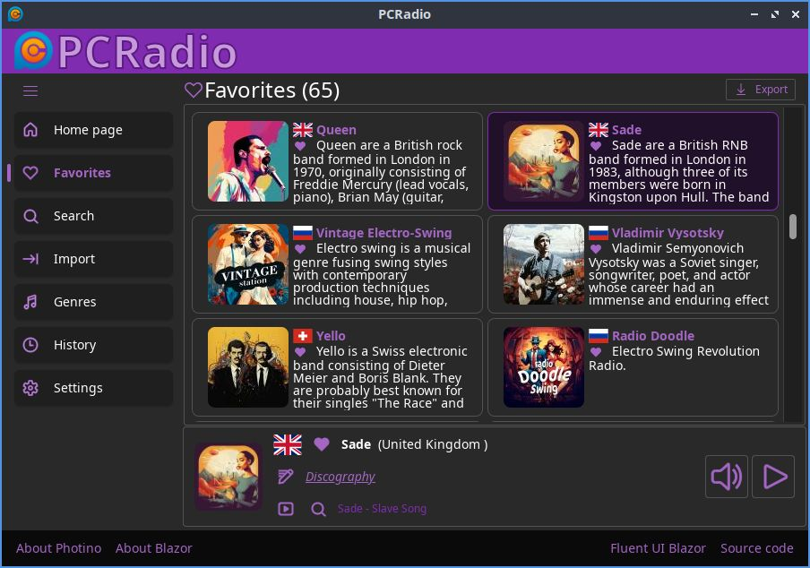

# 🎵 PCRadio — Desktop Internet Radio Player

PCRadio is a lightweight cross-platform internet radio player built with C#, .NET 10, and Photino.Blazor.
It provides a simple and modern desktop interface for listening to online radio streams from [PCRadio](https://pcradio.ru/).

[](https://dotnet.microsoft.com/download/dotnet/10.0)
[](https://dotnet.microsoft.com/languages/csharp)
[](https://opensource.org/licenses/MIT)



## ✨ Features
- Play online radio streams
- Cross-platform support (Windows, Linux, and macOS; macOS support is untested)
- Lightweight UI powered by Photino and Blazor
- Manage favorites station list
- Automatically keeps a history of all stations you've played.
- Search for the current song on YouTube
- Search and download the current song from [z3.fm](https://z3.fm/)
- Import radio stations from the [Radio Browser](https://www.radio-browser.info/) service 
- Edit radio station data
- Open-source and MIT licensed

## 🛠️ Built With
- **[.NET 10.0](https://dotnet.microsoft.com/download/dotnet/10.0)**: The core runtime and framework.
- **[C#](https://dotnet.microsoft.com/languages/csharp)**: The primary programming language.
- **[Photino.Blazor](https://github.com/tryphotino/photino.Blazor)**: A lightweight native window to host the Blazor UI.
- **[fluentui-blazor](https://github.com/microsoft/fluentui-blazor)**: Microsoft's official Fluent UI Blazor components for a modern design.
- **[SqlLite](https://sqlite.org/)**: A free and open-source relational database management system (RDBMS) that is self-contained, serverless, and highly reliable.

## 🚀 Quickstart

Download and run the latest release from the [Releases](https://github.com/poimenov/PCRadio/releases) page. If you don't have [.NET 10.0 Runtime](https://dotnet.microsoft.com/download/dotnet/10.0) installed, use self-contained version

## 💻 Run from source code

Prerequisites:
[.NET 10.0 SDK](https://dotnet.microsoft.com/download/dotnet/10.0)

```bash
git clone https://github.com/poimenov/PCRadio.git
cd PCRadio/src
```

Run:
```bash
dotnet run
```

## 📦 Build and publish

From the repository root, run the build script without arguments to publish the default project (`./src/PCRadio.csproj`):

```bash
dotnet fsi build.fsx
```

By default, the script publishes for `win-x64` and `linux-x64` and places the archives in `./artifacts`. Linux builds are packaged as `.tar.gz`; Windows and macOS builds as `.zip`.

You can optionally specify a project path, artifacts directory, and runtime identifiers:

```bash
dotnet fsi build.fsx ./src/PCRadio.csproj ./artifacts "win-x64,linux-x64,osx-x64"
```

## 📄 License
MIT — see LICENSE file for details.

